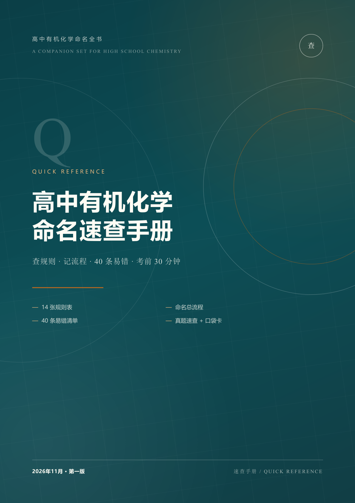
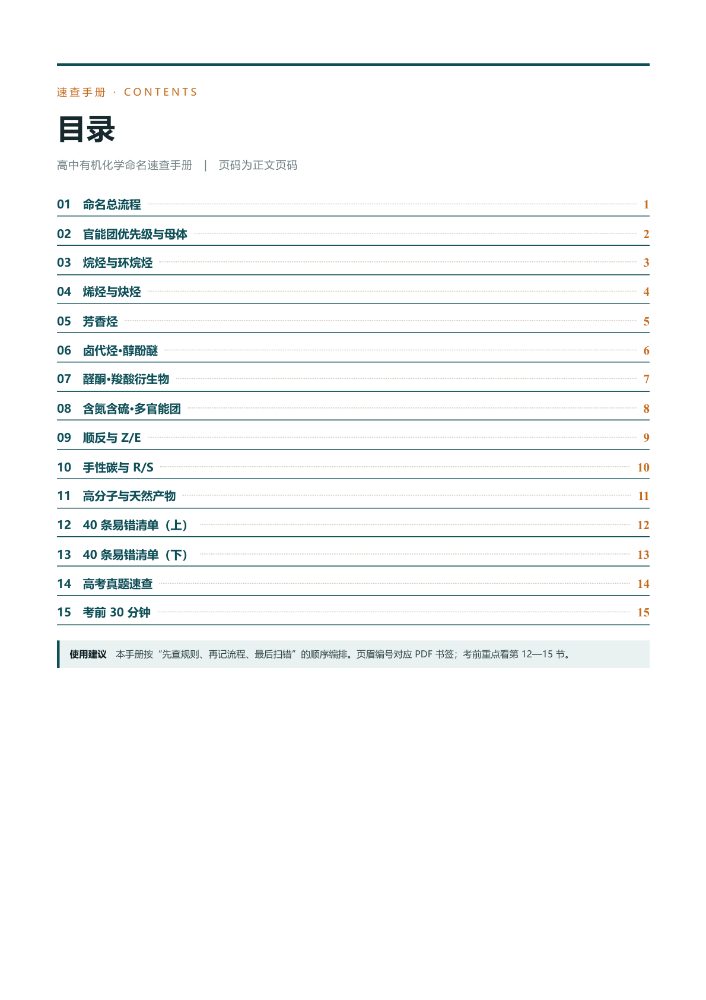
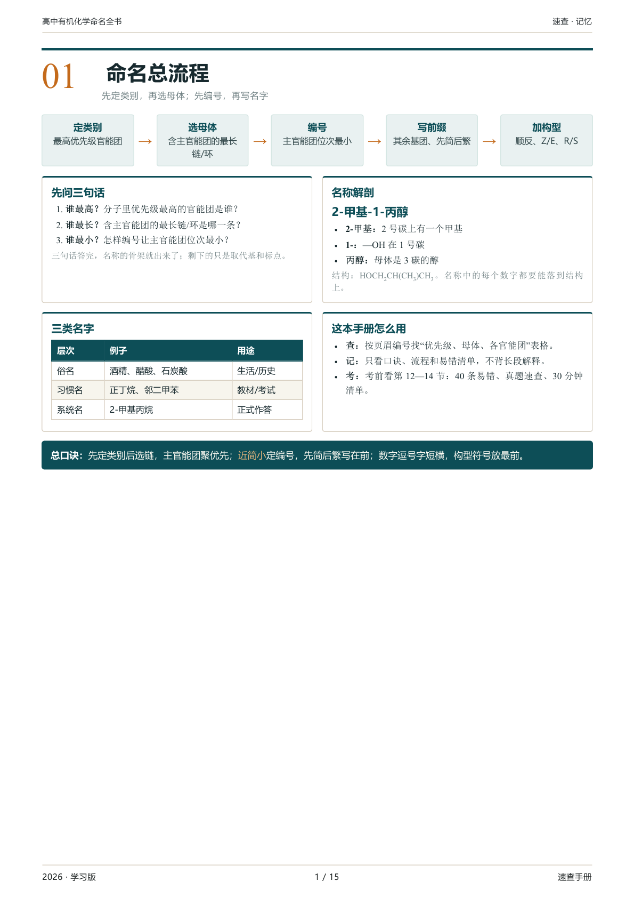
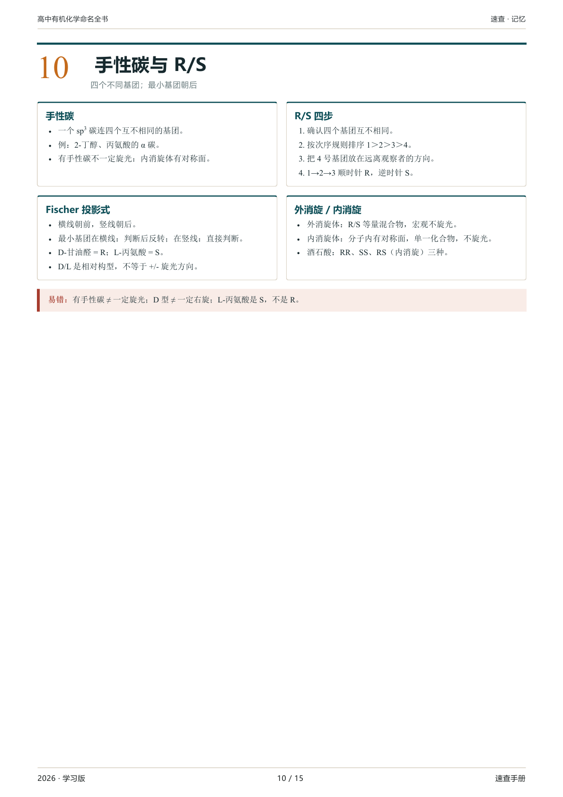

# 高中有机化学命名速查手册

> 不是百页教材，而是一本 **17 页**的查询与记忆手册。  
> 15 张速查页：流程、优先级、各类命名、40 条易错、真题答案、考前 30 分钟。

<p align="center">
  
</p>

## 下载

| 文件 | 内容 | 页数 | 下载 |
|---|---|---:|---|
| **高中有机化学命名速查手册** | 15 个速查主题 + 目录 + 封面 | 17 | [pdf/quick-handbook.pdf](pdf/quick-handbook.pdf) |

> 页眉编号对应目录与 PDF 书签；封面、目录不计入正文页码。

## 15 个速查页

| 编号 | 主题 | 你会在这一页查到 |
|---|---|---|
| 01 | 命名总流程 | 定类别 → 选母体 → 编号 → 写前缀 → 加构型；先问三句话 |
| 02 | 官能团优先级与母体 | 14 级优先级总表、母体选择四条规则、苯环/侧链判断 |
| 03 | 烷烃与环烷烃 | 长多近简小、编号例析、环烷烃、桥环/螺环公式 |
| 04 | 烯烃与炔烃 | 双键/三键主链、二烯、环烯、烯炔 |
| 05 | 芳香烃 | 邻间对、连偏均、多取代编号、侧链母体、TNT/苦味酸 |
| 06 | 卤代烃·醇酚醚 | 卤素作前缀、醇/酚/醚、常见易错 |
| 07 | 醛酮·羧酸衍生物 | 醛基/羧基为 1 位、酯名“酸 + 醇 + 酯”、酰胺/腈 |
| 08 | 含氮含硫·多官能团 | 胺、硝基、磺酸、硫醇；多官能团五步 |
| 09 | 顺反与 Z/E | 顺反条件、Z/E 三步、顺反 ≠ Z/E 的典型例子 |
| 10 | 手性碳与 R/S | 手性碳、R/S 四步、Fischer、外消旋/内消旋 |
| 11 | 高分子与天然产物 | 加聚/缩聚、PET、尼龙-66、单体判断 |
| 12 | 40 条易错（上） | 主链、编号、书写、官能团 20 条 |
| 13 | 40 条易错（下） | 苯环、立体、高分子 20 条 |
| 14 | 高考真题速查 | 2020—2025 高频答案 15 条 |
| 15 | 考前 30 分钟 | 六步自检、总口诀、可裁切口袋卡 |

## 预览

<p align="center">
  
  
  
</p>

## 怎么用

- **查**：按页眉编号找对应主题；每页只保留规则、表、例，不写长段解释。
- **记**：先背第 01 页总流程和第 02 页优先级口诀，再用第 03—11 页逐类过一遍。
- **考**：考前看第 12—15 页：40 条易错、真题答案、六步自检、口袋卡。

## 从源码构建

```bash
pip install -r requirements.txt
python -m playwright install chromium
python src/scripts/gen_structures.py
python src/scripts/build.py --book quick
```

输出在 `output/`，主文件为 `高中有机化学命名_速查手册.pdf`。

> 构建脚本仍保留早期长版手册与练习册的源码；当前主交付为 `--book quick`。版式默认使用 Windows 的 SimSun / Microsoft YaHei，其他系统可在 `src/assets/book.css` 与 `src/assets/quick.css` 中替换为 Noto Serif SC / Noto Sans SC。

## 说明

- 正文以人教版（2019）选择性必修3 与高考写法为主；CCS 2017/IUPAC 的差异只保留必要提示。
- 真题答案据公开试题与参考答案整理；不同地区评分细则可能接受“习惯名/系统名”并列写法。
- 本资料仅供学习交流，未经许可不得用于商业用途。
