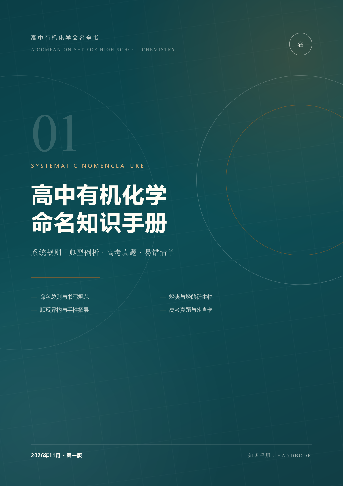
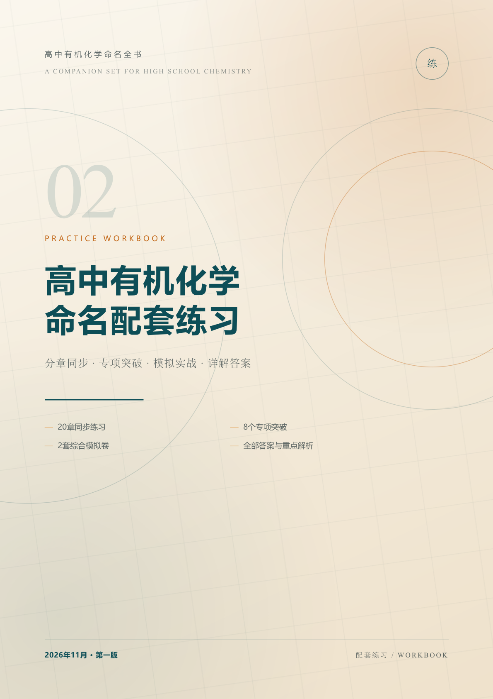

# 高中有机化学命名全书

> 一册知识手册 + 一册配套练习。  
> 以人教版（2019）选择性必修3 和高考评分习惯为主线，兼顾中国化学会《有机化合物命名原则 2017》的拓展写法。

<p align="center">
  
  
</p>

## 两册 PDF

| 分册 | 内容 | 页数 | 下载 |
|---|---|---:|---|
| **知识手册** | 20 章系统知识、例析、易错、真题、速查卡 | 110 | [pdf/handbook.pdf](pdf/handbook.pdf) |
| **配套练习** | 170 题：分章同步 100 + 专项 40 + 模拟 30，含答案解析 | 55 | [pdf/workbook.pdf](pdf/workbook.pdf) |

> PDF 内页页码与目录一致；封面与目录不计入正文页码。若 GitHub 在线预览较慢，请直接下载。

## 知识手册里有什么

- **第一编　命名规则基础**：命名体系、结构表示、烃基与语法、烷烃、环烷烃
- **第二编　不饱和烃与芳香烃**：烯烃、炔烃与二烯烃、芳香烃、顺反与 Z/E
- **第三编　烃的衍生物**：官能团优先级、卤代烃、醇酚醚、醛酮、羧酸及衍生物、含氮含硫、多官能团与天然产物
- **第四编　立体化学、高分子与综合**：手性 R/S、桥环螺环稠环杂环、高分子、高考真题与 40 条易错清单
- 附录：官能团优先级总表、常见基团、俗名对照、高中写法与 CCS 2017 对照、术语中英对照、可裁切速查卡

每章的结构式均为矢量 SVG，支持主链编号、苯环、双键/三键、立体楔线；重点内容用“规则卡 / 例析 / 易错 / 拓展 / 真题”分栏呈现。

## 配套练习里有什么

| 部分 | 内容 | 题量 |
|---|---|---:|
| 第一部分 | 20 章分章同步练，每章 5 题 | 100 |
| 第二部分 | 8 个专项：主链编号、取代基书写、苯环多取代、多官能团、名称→结构、顺反 Z/E、手性 R/S、高分子 | 40 |
| 第三部分 | 综合模拟卷 A、B，每套 15 题 | 30 |
| 第四部分 | 全部答案 + 易错题/综合题解析 | — |

每章末尾留有“错题记录”，答案按“章号-题号”“专一-1”“A-1”编排，方便自测后核对。

## 使用建议

1. 先读知识手册的一章，再做练习册对应 5 题。
2. 写名称时按“主官能团 → 母体 → 编号 → 取代基 → 标点 → 立体”的顺序检查。
3. 错题只记“错因关键词”（如“主链选短”“编号反了”“—OH 优先级高于卤素”），一周后重做。
4. 考前看知识手册第 20 章和附录速查卡；做两套模拟卷控制时间。

## 从源码构建

环境：Python 3.12+，Windows / macOS / Linux 均可（需有中文字体）。

```bash
pip install -r requirements.txt
python -m playwright install chromium

# 1. 生成结构式 SVG
python src/scripts/gen_structures.py

# 2. 生成两册 PDF
python src/scripts/build.py --book all
```

输出在 `output/`。构建脚本使用 HTML/CSS + Chromium 打印，PyMuPDF 负责目录书签、合并和元数据。

> 版式默认使用 Windows 的 SimSun / Microsoft YaHei。其他系统请在 `src/assets/book.css` 中把字体替换为 Noto Serif SC / Noto Sans SC 等中文字体。

## 主要参考

- 中国化学会.《有机化合物命名原则 2017》.
- IUPAC. *Nomenclature of Organic Chemistry* (Blue Book), 2013 recommendations.
- 人民教育出版社.《普通高中教科书·化学·选择性必修3 有机化学基础》，2019.
- 中华人民共和国教育部.《普通高中化学课程标准（2017 年版 2020 年修订）》.
- 2020—2025 年各地高考化学试题（公开资料）.
- 沈越, 李小瑞.《浅谈中国化学会〈有机化合物命名原则 2017〉的教学要点》. 大学化学, 2020.
- 李俊等.《有机化合物系统命名 CCS 2017 规则的基础教学研究》. 大学化学, 2022.

## 说明

- 高中教材与 CCS 2017 在取代基排序、烯烃名称、二醇名称等位置存在差异。本书正文以高中写法为主，2017/IUPAC 写法集中在“拓展”框和附录 D，考试时请以当地教材与评分细则为准。
- 真题答案据公开试题与参考答案整理，个别题目可能存在“习惯名/系统名”并列的情况，已尽量标注。
- 本资料仅供学习交流，未经许可不得用于商业用途。生成脚本可自由修改用于自己的学习资料。
